# CabSharing — System Design and UML

> Historical proposal draft. The current source-oriented design and UML are documented in [RideMatch-Software-Design.md](RideMatch-Software-Design.md).

**Version:** 1.0 (Design proposal)  
**Status:** For review and approval before implementation  
**Requirements baseline:** [CabSharing SRS](CabSharing-SRS.md)  
**Date:** 19 November 2026

> This is a design document, not implementation. All components and diagrams describe the proposed MVP. The MVP remains a layered Spring Boot modular monolith using Thymeleaf, Spring Data JPA, and MySQL.

## 1. Design overview

The application is organized into four layers: Presentation, Business, Persistence, and Database. A small domain model represents communities, user verification, rides, and participation. Ride coordination and fare calculation belong in business services rather than controllers or entity persistence code. The taxi booking remains external.

### Proposed package structure

```text
com.cabsharing
├── config/                 # Matching and replacement timeout settings
├── controller/             # Spring MVC controllers
├── dto/                    # Form/request and view response DTOs
├── domain/                 # JPA entities, enums, and domain behavior
├── exception/              # Domain exceptions and centralized handlers
├── repository/             # Spring Data JPA repository interfaces
├── service/                # Verification, ride, matching, fare, replacement
└── templates/              # Thymeleaf pages and reusable fragments
```

The structure separates responsibilities without creating a package or interface for every individual method. DTOs prevent web forms from binding directly to persistent entities. Entities keep fields private and expose focused operations that preserve invariants.

## 2. System architecture diagram

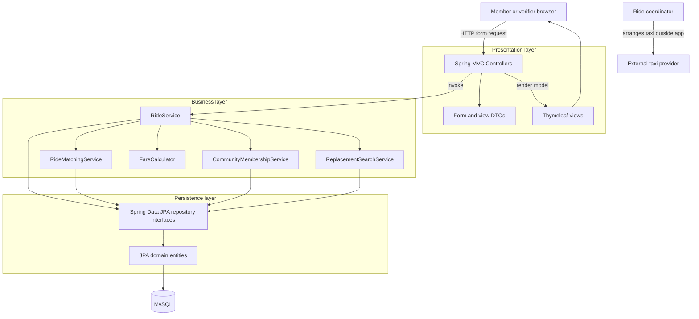

**Why this is useful:** Controllers handle HTTP and presentation concerns; services enforce business rules and coordinate transactions; repositories isolate persistence access; MySQL stores durable data. A failure or change in one layer has a limited impact on the others. The external provider is shown outside the system boundary because CabSharing does not book or dispatch taxis.

## 3. Use-case diagram

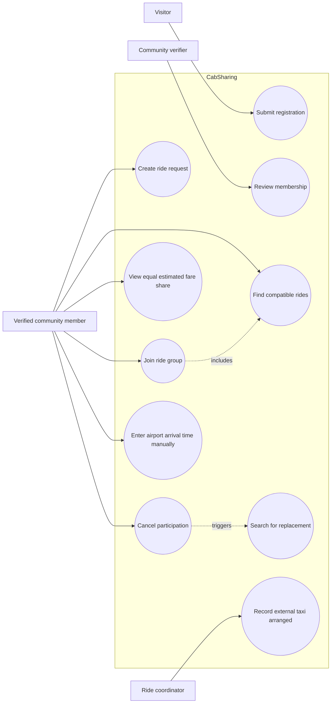

The diagram includes only actors and goals in the MVP. Visitors can submit membership details but do not get community ride access until verified. A coordinator is a verified member participating in a ride, not a separate account type.

## 4. Class diagram

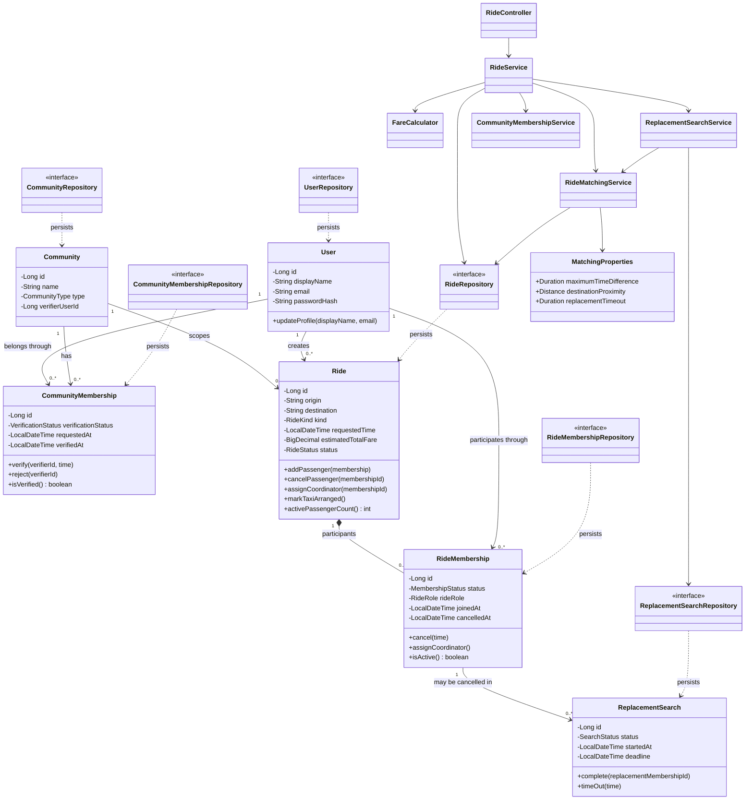

### Class responsibilities and design decisions

- **User** stores account identity and a password hash only. Passwords are never returned in view DTOs. It does not inherit from `Student` or `Employee`: both are community-member categories, not distinct behavior required by the MVP.
- **Community** represents a college or company boundary. A ride is scoped to one community, making same-community matching enforceable.
- **CommunityMembership** records the user's verification status within a community. Verification is community-specific; a person may belong to more than one community. `verify` and `reject` methods control status changes.
- **Ride** represents a ride request and the group being coordinated around it. `RideKind` distinguishes ordinary journeys from airport journeys; an airport arrival is entered into `requestedTime` manually. One model avoids separate ride subclasses without distinct rules.
- **RideMembership** represents one user's participation in one ride. `RideRole` is `COORDINATOR` or `PASSENGER`; coordinator is a passenger role, not an account hierarchy. The Ride aggregate enforces no more than one active coordinator and avoids duplicate active participation by the same user.
- **ReplacementSearch** records the search started by a cancellation and its terminal result. Storing its deadline and status makes the configured timeout and outcome explicit. It is operational state for the required replacement behavior, not a general job/workflow framework.
- **RideMatchingService** applies same-community, destination-proximity, and time-difference rules from `MatchingProperties`. The settings stay configurable rather than becoming scattered constants.
- **FareCalculator** is a focused domain service for equal estimated split calculation, separate from persistence and web handling.
- Repository interfaces are the persistence abstractions used by services. Spring Data supplies their JPA implementations; tests can substitute mocks. No separate interface is proposed for each service because the MVP has no alternate business-service implementation.

### Main enums

| Enum | Values |
|---|---|
| `CommunityType` | `COLLEGE`, `COMPANY` |
| `VerificationStatus` | `PENDING`, `VERIFIED`, `REJECTED` |
| `RideKind` | `STANDARD`, `AIRPORT` |
| `RideStatus` | `OPEN`, `COORDINATING`, `TAXI_ARRANGED` |
| `MembershipStatus` | `ACTIVE`, `CANCELLED` |
| `RideRole` | `PASSENGER`, `COORDINATOR` |
| `SearchStatus` | `SEARCHING`, `REPLACED`, `TIMED_OUT` |

`COMPLETED` is intentionally not a Ride status in this baseline because automatic trip completion was not specified in the SRS. If the project needs to record completion, it should be added as a reviewed requirement before implementation.

## 5. Entity Relationship Diagram (ERD)

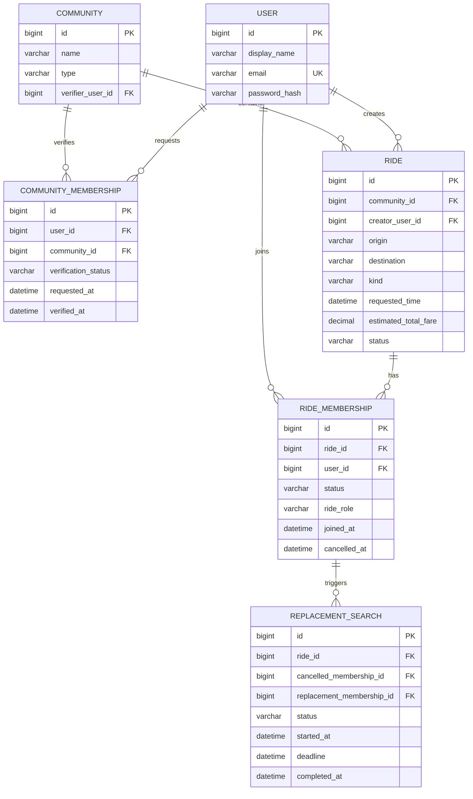

### Data constraints

- `USER.email` is unique.
- `(user_id, community_id)` is unique in `COMMUNITY_MEMBERSHIP`.
- `(ride_id, user_id)` is unique in `RIDE_MEMBERSHIP` to prevent duplicate membership rows for the same ride and user; a cancelled membership can be reactivated through controlled domain behavior if rejoining is allowed by the flow.
- `estimated_total_fare` must be positive and stored as a fixed-precision decimal, not floating point.
- Foreign keys preserve the relationships shown above. A community verifier is a user associated with that community; verifier authorization is checked in the service.
- Exactly one active coordinator is an aggregate invariant enforced by `Ride`/`RideService` transaction logic. A database uniqueness strategy may supplement it, but it must account for inactive/cancelled memberships.
- Replacement search references the ride and cancelled membership; `replacement_membership_id` is empty until a compatible replacement is accepted.

The ERD keeps verification separate from user identity because verification applies to a particular community. Ride membership is a join entity because it has its own role, status, and timestamps.

## 6. Sequence diagram — creating a ride

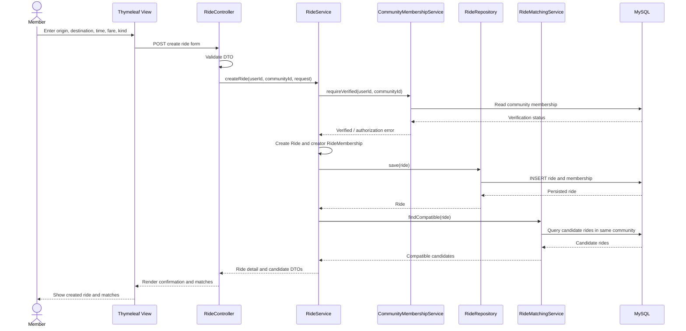

The creator is represented by a `RideMembership` so the ride group has a consistent participant model. Validation and verification occur before persistence. Matching reads candidates after the new ride is saved so the request can be returned with available matches.

## 7. Sequence diagram — joining a ride

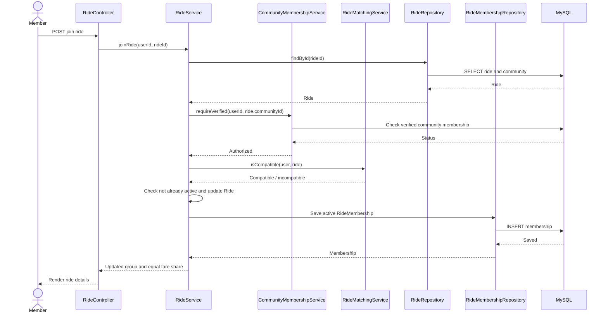

The application checks community verification and compatibility server-side even if a ride was visible in the browser. The join operation should execute transactionally so the active-member count and fare display reflect the saved group state.

## 8. Sequence diagram — cancelling and searching for a replacement

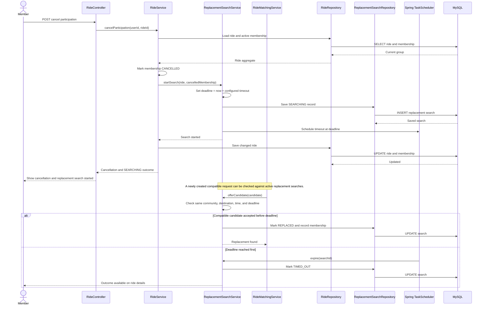

The search record makes the two-minute default and final outcome inspectable. `TaskScheduler` is an existing Spring facility used for the deadline; no message broker or distributed job platform is needed. Candidate matching remains within the application. Timeout and matching settings are configurable. The timeout operation must be idempotent so a candidate and deadline firing close together cannot both replace the same cancelled passenger.

## 9. Activity diagram — ride lifecycle

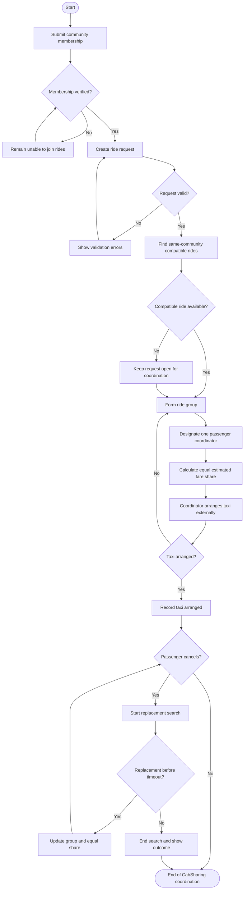

The activity ends at the boundary of CabSharing's coordination responsibility. The application does not monitor the actual taxi trip or claim that it is complete.

## 10. State transition diagrams

### 10.1 Ride

```mermaid
stateDiagram-v2
    [*] --> OPEN: valid ride created
    OPEN --> COORDINATING: members form group
    COORDINATING --> COORDINATING: member joins or cancellation/search runs
    COORDINATING --> TAXI_ARRANGED: coordinator records external arrangement
    TAXI_ARRANGED --> TAXI_ARRANGED: membership changes; recalculate share
```

`OPEN` means the request is available for coordination; `COORDINATING` means a group exists. Taxi arrangement is a recorded coordination fact, not a CabSharing booking. The diagram has no ride-withdrawal transition because cancelling an entire ride was not specified in the SRS. Terminal trip completion is omitted because the SRS does not require trip tracking. A change after taxi arrangement updates the group and fare share while retaining the recorded arrangement state; the coordinator communicates any change to the provider externally.

### 10.2 RideMembership

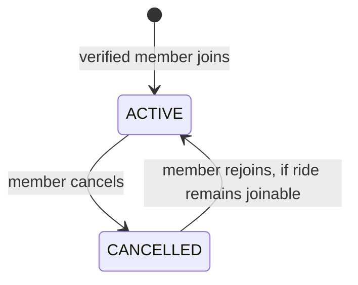

Rejoining reactivates the same `(ride, user)` membership rather than creating a duplicate. If the ride is no longer joinable, the join attempt is rejected and the state stays `CANCELLED`.

## 11. Component diagram

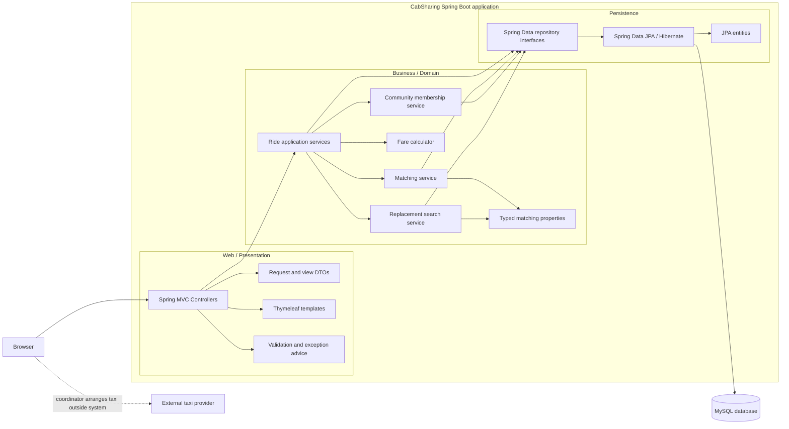

The component diagram separates web concerns from use-case orchestration and persistence. `Errors` centralizes form validation and domain exception translation. Configuration properties centralize matching thresholds and the replacement timeout for easier demonstration and adjustment.

## 12. OOP and SOLID mapping

### Object-oriented design

- **Encapsulation:** Entity fields are private. For example, `Ride.cancelPassenger`, `Ride.assignCoordinator`, and `CommunityMembership.verify` control state changes and can enforce invariants. Controllers/services do not directly edit entity fields.
- **Abstraction:** Services depend on Spring Data repository interfaces such as `RideRepository`; they use persistence operations without depending on a concrete database access class. This abstraction has a real persistence and testability purpose.
- **Polymorphism:** The repository interfaces are implemented by Spring Data JPA-generated runtime proxies. A service can use the same repository contract with the JPA implementation in the application and a Mockito mock in unit tests. No artificial business inheritance hierarchy is needed.
- **Inheritance:** No domain inheritance is proposed. `Student`, `Employee`, and `AirportPassenger` are not distinct IS-A subtypes needed by the described rules. Enums and composition express the actual variation more simply.

### SOLID principles and concrete participants

| Principle | Classes / design | Why it fits |
|---|---|---|
| Single Responsibility (SRP) | `RideController`, `RideService`, `RideMatchingService`, `FareCalculator`, `CommunityMembershipService`, `ReplacementSearchService`, repositories | Each class owns one concern: HTTP, use-case orchestration, match decisions, fare math, verification, replacement lifecycle, or persistence access. |
| Open/Closed (OCP) | `RideMatchingService` reads `MatchingProperties`; repository access is via interfaces | Matching thresholds can change through configuration without rewriting controller or persistence code. The design does not create speculative strategy hierarchies; a new matching policy would be introduced only if a real second policy is required. |
| Liskov Substitution (LSP) | `RideRepository` and other repository interfaces | Spring Data implementations and test doubles must honor the repository contract: return the requested persisted data or the documented absence/error result. No subtype may weaken the contract. |
| Interface Segregation (ISP) | Focused repository interfaces; no broad `RideManager` interface | Each persistence contract covers one aggregate/data purpose. Controllers/services are not forced to implement unrelated methods. |
| Dependency Inversion (DIP) | `RideService`, `RideMatchingService`, `CommunityMembershipService`, and `ReplacementSearchService` depend on repository abstractions | Business decisions do not depend directly on Hibernate implementation classes or SQL details. Spring injects repository implementations. |

SOLID is demonstrated through responsibility boundaries and useful abstractions, not by adding interfaces to every class. Since there is one planned implementation for each business service, the controller can depend on the concrete service class without a redundant service interface.

## 13. Transaction and validation boundaries

- Controller DTO validation handles required fields and basic formats; business services repeat security-sensitive checks such as community verification and ride compatibility.
- Creating or joining a ride is transactional. Membership and ride changes that affect the active group/fare should commit together.
- Cancelling a passenger and recording the replacement search should leave a consistent database state. Scheduling the timeout happens after the search record is persisted; duplicate expiration calls must be harmless.
- Fare share is calculated from active memberships whenever a ride detail is presented or group state changes. The fare remains an estimate.
- A centralized exception handler maps validation, not-found, authorization, and conflict errors to understandable Thymeleaf responses.

These boundaries help prevent invalid membership or partially updated ride groups from reaching the database. Exact transaction annotations and schema mappings belong to implementation, after design approval.

## 14. Decisions requiring confirmation during implementation planning

The SRS intentionally leaves matching thresholds configurable without choosing numeric values. The implementation setup will need initial demonstration values for destination proximity and maximum time difference. The verifier's source of evidence is also community-specific and remains a manual project-level process unless requirements are later refined. Neither item changes the architecture or expands the MVP.

**Approval gate:** No application code has been generated. Implementation should begin only after this system design is approved.
