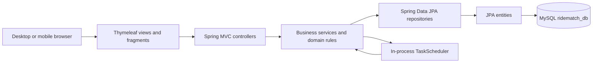
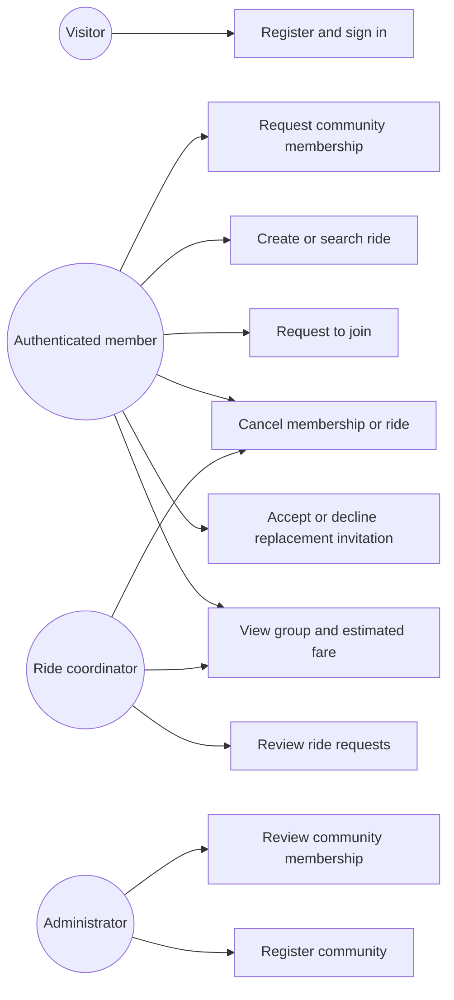
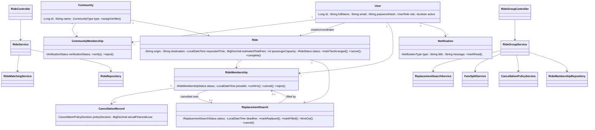
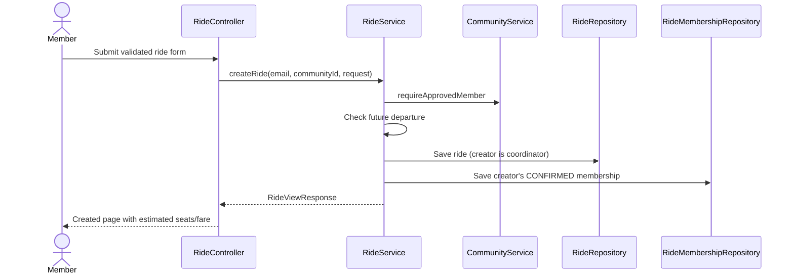
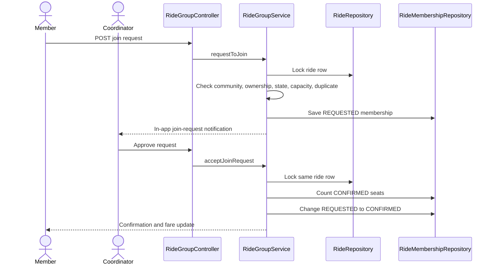
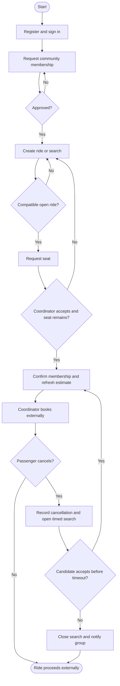
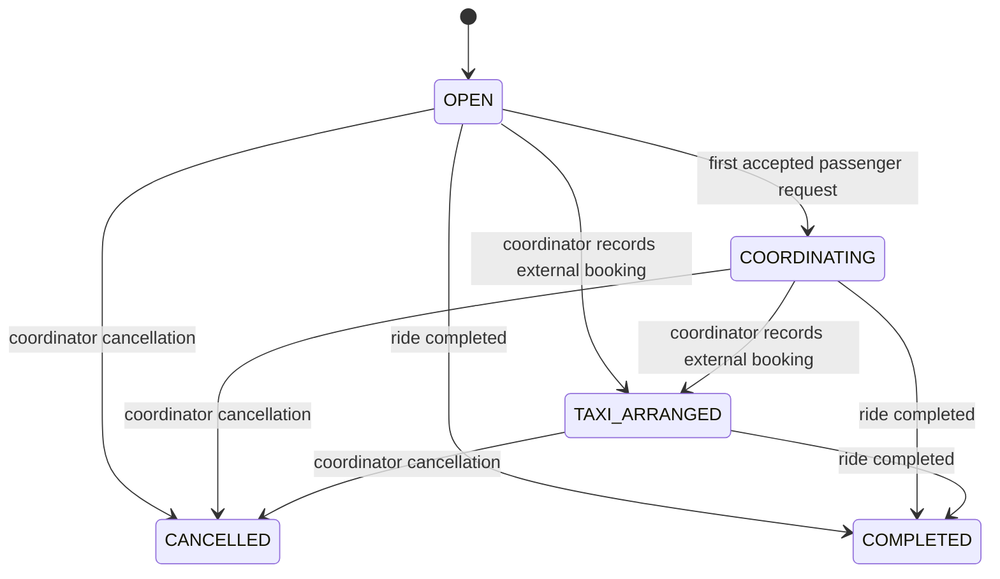
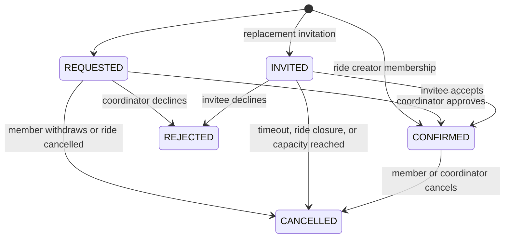
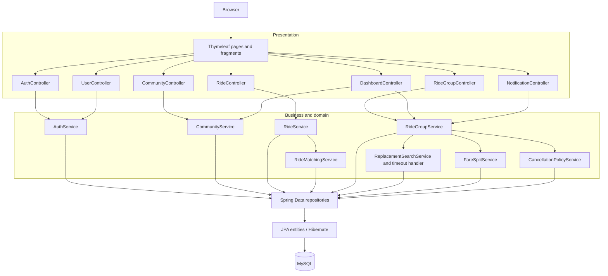

# RideMatch — Software Design Document and UML

**Version:** 1.0 · **Status:** As-built source review · **Runtime verification:** Not completed

This document describes the current source tree. It supersedes the earlier CabSharing proposal where names or classes differ. Diagrams are Mermaid source and should be rendered by a Mermaid-capable Markdown viewer.

## 1. Architecture

RideMatch is a Spring Boot modular monolith. A Thymeleaf/browser request enters a controller, invokes a business service, accesses repositories, and persists through JPA/Hibernate to MySQL. Scheduled replacement deadlines run in-process. Taxi booking remains external.



## 2. Use-case diagram



## 3. Class diagram



Repositories are Spring Data interfaces; there are no custom repository abstraction layers beyond those interfaces. Services use constructor injection. Entities keep fields private and expose controlled state methods. Inheritance is limited to `AuditableEntity`, a shared persistence timestamp base class.

## 4. Entity relationship diagram

```mermaid
erDiagram
  USERS ||--o{ COMMUNITY_MEMBERSHIPS : requests
  COMMUNITIES ||--o{ COMMUNITY_MEMBERSHIPS : verifies
  USERS ||--o{ RIDES : creates
  USERS ||--o{ RIDES : coordinates
  COMMUNITIES ||--o{ RIDES : contains
  RIDES ||--o{ RIDE_MEMBERSHIPS : includes
  USERS ||--o{ RIDE_MEMBERSHIPS : participates
  RIDE_MEMBERSHIPS ||--o{ CANCELLATION_RECORDS : history
  RIDES ||--o{ REPLACEMENT_SEARCHES : searches
  RIDE_MEMBERSHIPS ||--o| REPLACEMENT_SEARCHES : cancelled_membership
  RIDE_MEMBERSHIPS o|--o{ REPLACEMENT_SEARCHES : filled_membership
  USERS ||--o{ NOTIFICATIONS : receives
  RIDES o|--o{ NOTIFICATIONS : context
  USERS { bigint id PK; varchar email UK; varchar password_hash; varchar user_role; boolean active }
  COMMUNITIES { bigint id PK; varchar name; varchar community_type; bigint verifier_user_id FK }
  COMMUNITY_MEMBERSHIPS { bigint id PK; bigint user_id FK; bigint community_id FK; varchar verification_status; bigint verified_by_user_id FK }
  RIDES { bigint id PK; bigint community_id FK; bigint creator_user_id FK; bigint coordinator_user_id FK; varchar origin; varchar destination; datetime requested_time; decimal estimated_total_fare; int passenger_capacity; varchar status }
  RIDE_MEMBERSHIPS { bigint id PK; bigint ride_id FK; bigint user_id FK; bigint replacement_search_id FK; varchar membership_status; datetime joined_at }
  REPLACEMENT_SEARCHES { bigint id PK; bigint ride_id FK; bigint cancelled_membership_id FK_UK; bigint filled_by_membership_id FK; varchar search_status; datetime deadline }
  CANCELLATION_RECORDS { bigint id PK; bigint ride_membership_id FK; varchar outcome; varchar policy_decision; decimal actual_financial_loss }
  NOTIFICATIONS { bigint id PK; bigint user_id FK; bigint ride_id FK; varchar notification_type; datetime read_at }
```

The schema has unique user/email, community membership user/community, and ride membership ride/user constraints. Replacement search has a unique cancelled-membership reference. Only confirmed membership rows count as seats.

## 5. Sequence — create ride



## 6. Sequence — request and accept a seat



## 7. Sequence — cancellation and replacement

```mermaid
sequenceDiagram
  actor Passenger
  participant C as RideGroupController
  participant GS as RideGroupService
  participant RR as RideRepository
  participant MR as RideMembershipRepository
  participant RS as ReplacementSearchService
  participant DB as MySQL
  participant T as TaskScheduler
  participant Invitee as Verified candidate
  Passenger->>C: Cancel confirmed membership
  C->>GS: cancelOwnMembership
  GS->>RR: Lock ride row
  GS->>MR: Set membership CANCELLED; save cancellation record
  GS->>RS: Start replacement search
  RS->>DB: Persist search/deadline
  RS->>T: Schedule timeout
  RS->>DB: Persist one INVITED membership
  RS-->>Invitee: Replacement invitation
  alt Invitee accepts
    Invitee->>GS: Accept invitation
    GS->>RR: Lock ride
    GS->>MR: Recheck capacity and confirm membership
    GS->>DB: Mark search REPLACED; update estimated split
  else Invitee rejects or deadline expires
    GS->>RS: Invite next candidate or close search
    RS-->>Passenger: Group notification on completion/timeout
  end
```

## 8. Activity — ride lifecycle



## 9. State transitions





## 10. Component diagram



## 11. OOP, SOLID, and review notes

- **Encapsulation:** `Ride`, `RideMembership`, `ReplacementSearch`, and `CommunityMembership` keep fields private and provide state-changing methods.
- **Abstraction / DIP:** services depend on repository interfaces and Spring's `PasswordEncoder`/`TaskScheduler` contracts. No extra application interface is needed for each service.
- **Polymorphism:** no substantial application-level polymorphic behavior is currently required; Spring interface implementations supply repository/encoder/scheduler implementations.
- **Inheritance:** `AuditableEntity` centralizes timestamp behavior for persisted entities. No user/role inheritance hierarchy exists.
- **SRP:** controllers bind requests; services orchestrate business rules; repositories expose persistence operations; DTOs shape forms/views.
- **OCP:** matching thresholds and alias groups are configuration properties. This is a bounded extension point; the service otherwise contains the current rule-based strategy.
- **LSP / ISP:** no custom inheritance/interface hierarchy is introduced to claim these principles. Repository interfaces remain focused on persistence.

## 12. Transactions and known design gaps

Mutating group operations are transactional. `RideRepository.findByIdForUpdate` locks the ride row before seat counts and membership decisions. This is source-reviewed but not tested under concurrent database transactions. Replacement deadline callbacks lock the ride before the search; early callbacks reschedule themselves. Search candidate selection remains sequential and broad, and MySQL schema migration/restart behavior requires runtime verification.

